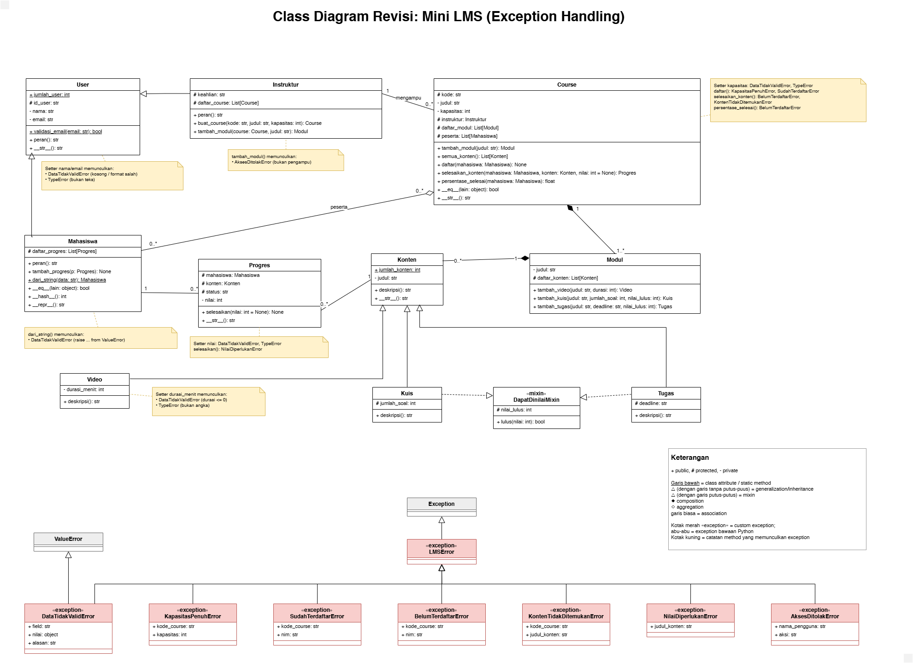

# Mini LMS: Exception Handling

Mini LMS dimodelkan dengan pendekatan OOP dan diimplementasikan dalam Python, lalu pada tugas ini ditambah **exception handling**: setiap penolakan data atau pelanggaran aturan bisnis dilaporkan sebagai exception yang dapat ditangkap dan ditangani oleh pemanggil.

## 1. Identitas
| Judul studi kasus: | Studi Kasus No. 7: Mini LMS |
| ------------------ | --------------------------- |

| Nama                           | NIM        |
| ------------------------------ | ---------- |
| I Made Suartana Dwi Putra      | 2501020045 |
| I wayan pasek bagus Adi Wijaya | 2501020077 |
| I Putu Siva Adi Putra          | 2501020063 |

## 2. Deskripsi Sistem

Mini LMS (Learning Management System) adalah sistem pembelajaran daring sederhana yang digunakan oleh dua jenis pengguna, yaitu **instruktur** dan **mahasiswa**. Instruktur membuat course, menyusun modul di dalam course, dan mengisi setiap modul dengan konten pembelajaran berupa video, kuis, atau tugas. Mahasiswa mendaftar ke course yang tersedia, lalu mempelajari konten satu per satu.

Yang dikelola sistem adalah course, modul, konten, data pengguna, dan progres belajar. Progres dicatat per konten untuk setiap mahasiswa: status `belum`, `selesai`, atau `ulang`, serta nilai untuk konten yang dinilai (kuis dan tugas). Proses utama meliputi pembuatan course dan modul, penambahan konten, pendaftaran mahasiswa (dibatasi kapasitas), penyelesaian konten, penilaian, dan penghitungan persentase penyelesaian course. Seluruh pelanggaran aturan pada proses tersebut dilaporkan melalui hierarki custom exception turunan `LMSError`.

## 3. Tabel Aturan Bisnis

| No | Aturan | Class / method yang menegakkan | Exception yang dimunculkan |
|---|---|---|---|
| 1 | Nama tidak boleh kosong dan email harus berformat valid | `User.nama`, `User.email` (setter) | `DataTidakValidError`, `TypeError` |
| 2 | Durasi video harus lebih dari 0 menit | `Video.durasi_menit` (setter) | `DataTidakValidError`, `TypeError` |
| 3 | Kapasitas course harus lebih dari 0 dan tidak boleh kurang dari jumlah peserta | `Course.kapasitas` (setter) | `DataTidakValidError`, `TypeError` |
| 4 | Nilai progres harus antara 0 dan 100 | `Progres.nilai` (setter) | `DataTidakValidError`, `TypeError` |
| 5 | Jumlah peserta tidak boleh melebihi kapasitas course | `Course.daftar()` | `KapasitasPenuhError` |
| 6 | Mahasiswa tidak boleh mendaftar dua kali ke course yang sama | `Course.daftar()` | `SudahTerdaftarError` |
| 7 | Hanya mahasiswa yang terdaftar yang boleh menyelesaikan konten atau dihitung progresnya | `Course.selesaikan_konten()`, `Course.persentase_selesai()` | `BelumTerdaftarError` |
| 8 | Konten yang diselesaikan harus ada di dalam course tersebut | `Course.selesaikan_konten()` | `KontenTidakDitemukanError` |
| 9 | Kuis dan tugas hanya dapat diselesaikan jika disertai nilai | `Progres.selesaikan()` | `NilaiDiperlukanError` |
| 10 | Hanya instruktur pengampu yang boleh menambah modul ke course | `Instruktur.tambah_modul()` | `AksesDitolakError` |
| 11 | Data mahasiswa dari string harus berformat `nim;nama;email` | `Mahasiswa.dari_string()` | `DataTidakValidError` (memakai `raise ... from`) |

## 4. Class Diagram Revisi

## 5. Daftar Custom Exception

| Nama | Class induk | Atribut konteks | Kapan dimunculkan | Method yang memunculkan | Cara program menanganinya |
|---|---|---|---|---|---|
| `LMSError` | `Exception` | (base, tanpa atribut) | Tidak dimunculkan langsung; menjadi induk semua exception aplikasi | (tidak ada) | Ditangkap dengan `except LMSError` sebagai penangkap umum |
| `DataTidakValidError` | `LMSError`, `ValueError` | `field`, `nilai`, `alasan` | Data tidak memenuhi aturan validasi (nama kosong, email salah, durasi, kapasitas, nilai di luar 0-100, format string salah) | Setter `User.nama`, `User.email`, `Video.durasi_menit`, `Course.kapasitas`, `Progres.nilai`; `Mahasiswa.dari_string` | Dicetak beserta `field` dan penyebab (`__cause__`) pada Skenario 3 |
| `KapasitasPenuhError` | `LMSError` | `kode_course`, `kapasitas` | Pendaftaran melebihi kapasitas course | `Course.daftar` | Dicatat log lalu di-raise ulang di `daftarkan()`, kemudian pendaftaran ditolak di Skenario 2 |
| `SudahTerdaftarError` | `LMSError` | `kode_course`, `nim` | Mahasiswa mendaftar dua kali ke course yang sama | `Course.daftar` | Pesan penolakan pada Skenario 2 |
| `BelumTerdaftarError` | `LMSError` | `kode_course`, `nim` | Mahasiswa yang belum terdaftar menyelesaikan konten atau dihitung progresnya | `Course.selesaikan_konten`, `Course.persentase_selesai` | Ditangkap lewat `except LMSError` |
| `KontenTidakDitemukanError` | `LMSError` | `kode_course`, `judul_konten` | Konten yang diselesaikan tidak ada di course | `Course.selesaikan_konten` | Ditangkap lewat `except LMSError` |
| `NilaiDiperlukanError` | `LMSError` | `judul_konten` | Kuis atau tugas diselesaikan tanpa nilai | `Progres.selesaikan` | Pesan penolakan pada Skenario 4 |
| `AksesDitolakError` | `LMSError` | `nama_pengguna`, `aksi` | Instruktur mengubah course yang bukan miliknya | `Instruktur.tambah_modul` | Pesan penolakan pada Skenario 4 |
